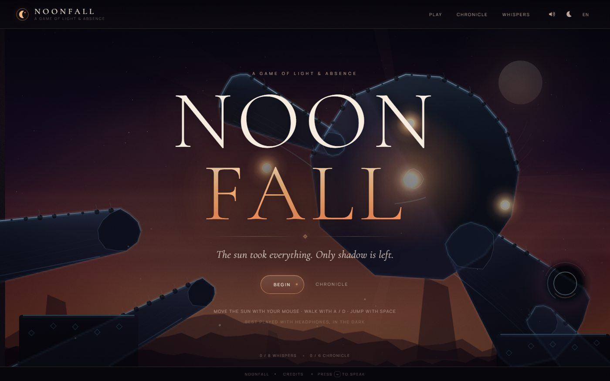
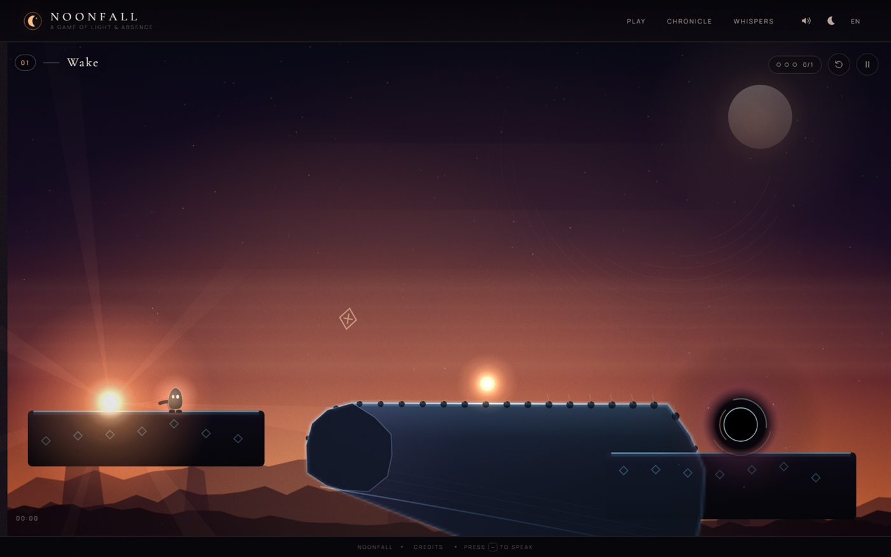
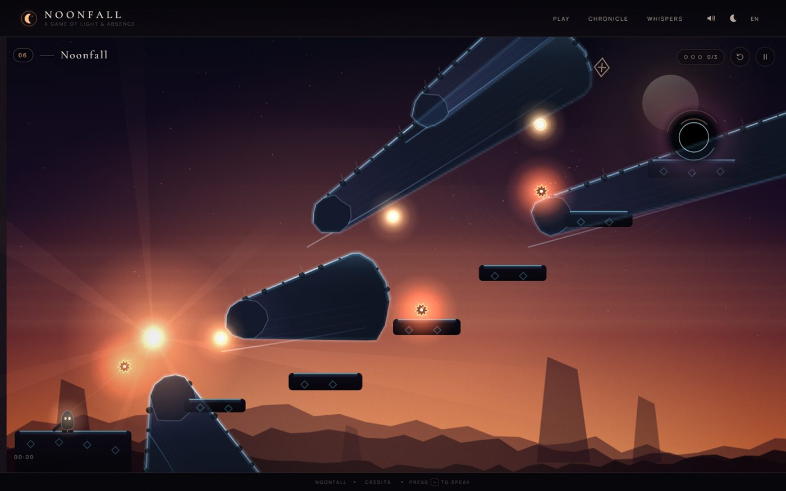
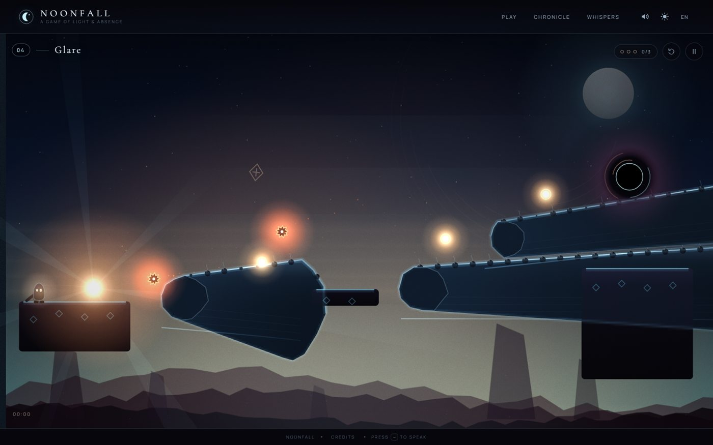
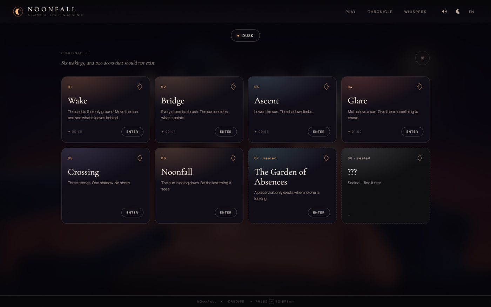
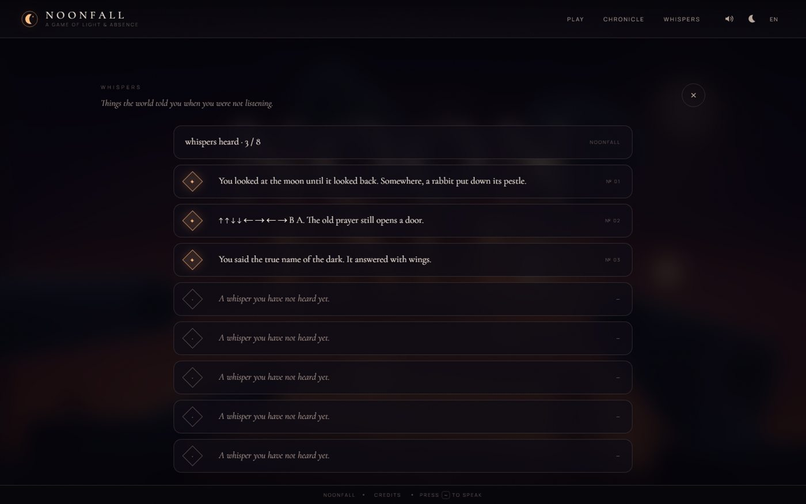
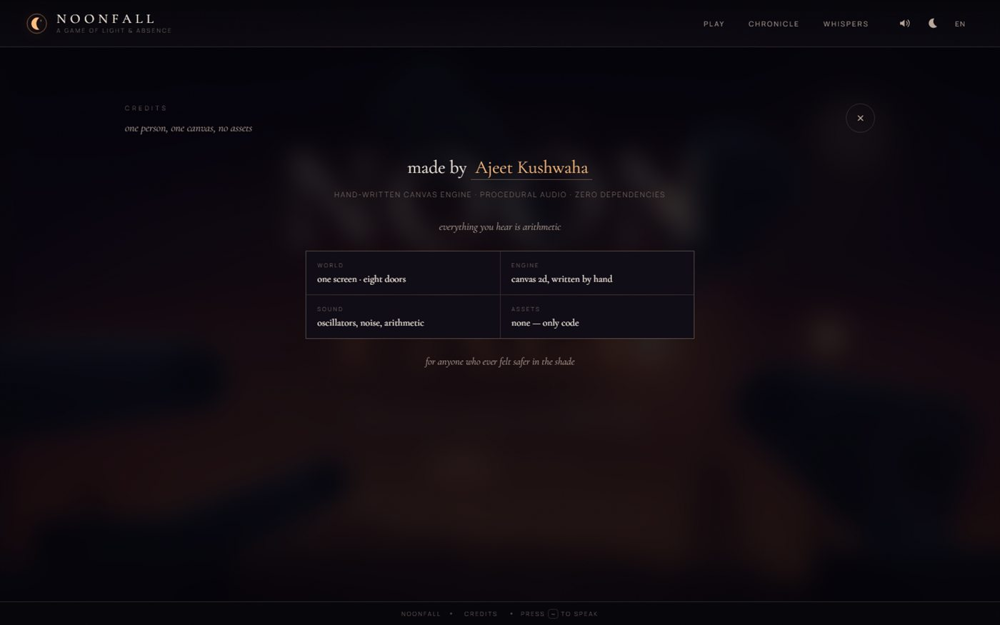
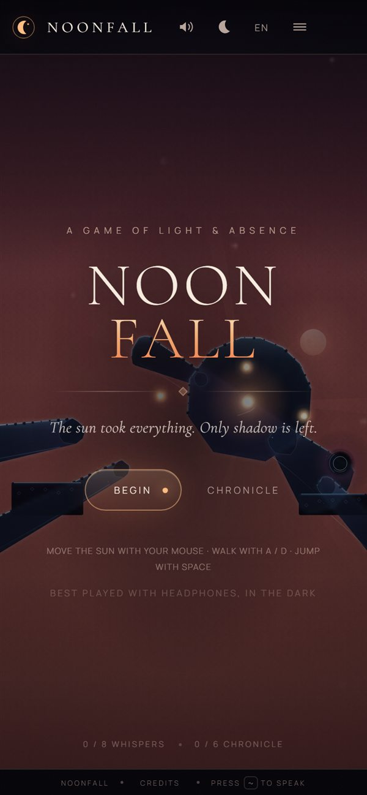
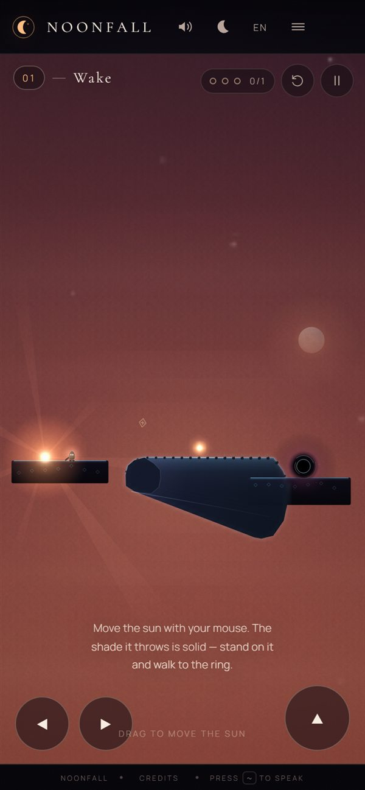

<div align="center">



# NOONFALL

**a game of light &amp; absence**

### [▶ Play it in your browser](https://ajeet-iitk.github.io/noonfall/)

No install · no assets · no dependencies · one sun you can move

</div>

---

**NOONFALL** is a single-screen puzzle-platformer set in a flatland the sun has almost finished erasing. You are a small shade-creature. The world is dark, and the dark is the only ground — until you move the sun.

Every stone throws a solid shadow. Where the shadow falls, you can walk. Where the light falls, the world simply isn't there any more.

There is no jump button for the sun. There is only your mouse.

---

## The rule of shade

| Action | Control |
| --- | --- |
| Move the sun / lantern | **mouse** (or drag on touch) |
| Walk | **A / D** or **← / →** |
| Jump | **Space / W / ↑** |
| Pause | **Esc** |
| Restart level | **R** |
| Show hint | **H** |
| Speak to the machine | **~** |
| Change language | **EN / हिं / HG** button |
| Change day / night | moon / sun button |

Shade is **one-way**: you can rise through it from below, but it never blocks you sideways. Only the old stone terraces are walls. Walk into a rising shadow and it lifts you.

The sun is not a cursor. It is a physical light. Pull it low and the shadows climb. Push it far and they stretch. Put it behind you and the path disappears.

---

## Screenshots

<div align="center">

| | |
| --- | --- |
|  |  |
| *Wake — the first shadow* | *Noonfall — the last staircase* |
|  |  |
| *Moon mode — the same world, colder* | *The Chronicle — six wakings and two doors* |
|  |  |
| *Whispers — things the world told you* | *Credits — one person, one canvas* |




</div>

---

## What's inside

- **8 hand-built levels** — six wakings, plus two doors that should not exist.
- **A sun you can move** — every shadow is a convex hull cast from a real light point. The geometry is the puzzle.
- **Motes** — small hungry things that chase the light and are repelled by shade.
- **Ink** — one hidden drop per level. Collect them all for a whisper.
- **Glyphs** — six sigils hidden in the geometry. Find every one and a new door opens.
- **8 secrets / whispers**, including a Konami rite, a true name, a moon that blinks, an author behind the author, and a terminal that answers.
- **Three languages** — English, हिन्दी, and Hinglish.
- **Day / night** — dusk and moon palettes, persisted between visits.
- **Procedural audio** — every pad, bell, footstep and sting is generated with oscillators and noise. No audio files.
- **Touch controls** — a portrait layout that keeps the whole diorama visible.
- **Zero dependencies** — hand-written canvas engine, classic scripts, works from `file://`.

---

## Secrets

<details>
<summary><b>Open the whisper index (spoilers)</b></summary>

There are eight whispers. Each one is a secret. The game remembers them in `localStorage`.

1. **The moon blinks** — click the moon seven times.
2. **The old prayer** — enter the Konami code: ↑ ↑ ↓ ↓ ← → ← → B A.
3. **The true name** — type `umbra` anywhere. It grants a double jump.
4. **The smaller author** — open Credits and click the author's name five times.
5. **Every drop** — collect every ink drop in a single level.
6. **The abyss is patient** — fall thirteen times, across any levels.
7. **Every glyph** — touch all six glyphs in the six main levels. This also opens *The Long Dark*.
8. **Speak, machine** — press `~` and enter any command in the terminal.

The terminal understands `help`, `night`, `dusk`, `umbra`, `garden`, `longdark`, `whisper`, `who`, `13`, and `hello`.

Two secret levels exist: **The Garden of Absences** (open it with the Konami rite or the terminal) and **The Long Dark** (open it by finding every glyph).

</details>

---

## How it is made

Everything is in this repository, and there is no build step.

```
index.html                 the whole shell
assets/css/style.css       themes, HUD, screens, modals, responsive layout
assets/js/util.js          geometry, convex hulls, shadow casting, easing
assets/js/audio.js         procedural WebAudio pads, bells, reverb, sfx
assets/js/levels.js        eight levels + the title diorama
assets/js/i18n.js          EN / हिंदी / Hinglish strings and whispers
assets/js/engine.js        physics, light, shade, particles, rendering
assets/js/ui.js            screens, progress, secrets, terminal
assets/js/main.js          boot and the animation loop
favicon.svg                the crescent-lantern
```

The shadow of each stone is a convex polygon: the stone's hull, projected away from the sun, extended by a length that grows with distance. The player collides with those polygons from above only. The renderer draws the same polygons as ink, with a bright rim along every walkable edge.

The audio graph is a few detuned oscillators through a generated impulse-response reverb, plus short noise bursts for footsteps and impacts. There are no samples.

---

## Run it locally

Because the game uses classic `<script>` tags, you can open `index.html` directly. For the best experience (and to avoid browser font/CORS quirks), serve the folder:

```bash
# Python
python -m http.server 8080

# or Node
npx serve .
```

Then open <http://localhost:8080/>.

---

## Credits

**Made by [Ajeet Kushwaha](https://github.com/Ajeet-iitk).**

One person, one canvas, no assets. The sun is a point. The shade is a hull. Everything you hear is arithmetic.

*For anyone who ever felt safer in the shade.*
